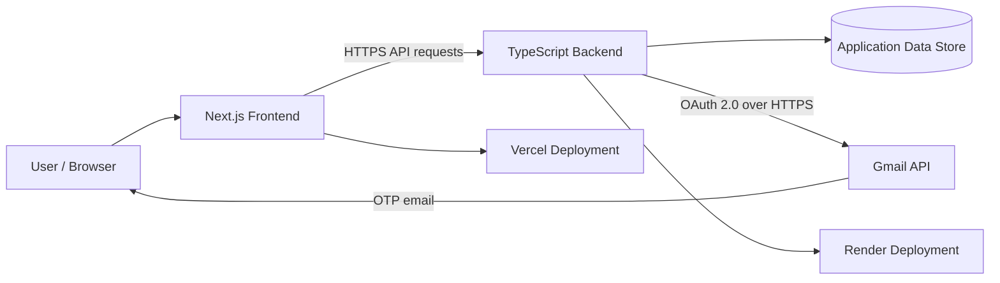

<!-- Bastion Academy README. Never commit secrets or .env files. -->
<div align="center">

# 🛡️ Bastion Academy

### A modern learning platform focused on usability, security, and reliable learning workflows.

<p>
  <a href="https://bastion-academy.vercel.app"><strong>🚀 Live Application</strong></a> ·
  <a href="https://github.com/DEVARAKONDA72613/bastion-academy"><strong>💻 Source Code</strong></a> ·
  <a href="https://bastion-academy-api.onrender.com/health"><strong>🩺 API Health</strong></a>
</p>

<p>
  
  
  
  
  
</p>

*Learn with clarity. Build with confidence.*

</div>

---

## ✨ About

**Bastion Academy** is a full-stack web application that brings core learning-platform workflows together in one place. It combines a responsive Next.js frontend with a TypeScript backend, with attention to authentication, access control, and dependable user flows.

## 🚀 Live links

| Resource | Link |
| --- | --- |
| **Live application** | [bastion-academy.vercel.app](https://bastion-academy.vercel.app) |
| **Backend API** | [bastion-academy-api.onrender.com](https://bastion-academy-api.onrender.com) |
| **API health check** | [Check service health](https://bastion-academy-api.onrender.com/health) |
| **Source repository** | [GitHub repository](https://github.com/DEVARAKONDA72613/bastion-academy) |

## 🎯 Features

<details open>
<summary><strong>🔐 Authentication and account flows</strong></summary>

- Registration and account-verification workflows.
- One-time passcode (OTP) email delivery through the Gmail API.
- Password-reset flow.
- Protected API routes and permission checks.
- Generic account-recovery responses to reduce account enumeration.

</details>

<details>
<summary><strong>📚 Learning and platform APIs</strong></summary>

- Course API for learning content.
- Plans API for available platform plans.
- Frontend and backend separated for clearer responsibilities.
- API health endpoint for deployment verification.

</details>

<details>
<summary><strong>🛡️ Security and reliability</strong></summary>

- Permission and moderation test coverage.
- Download-quota handling and quota-race testing.
- Security headers and public privacy/terms pages.
- Robots and sitemap files for search-engine discovery.
- Environment-based configuration for deployment credentials.

</details>

<details>
<summary><strong>🎨 User experience</strong></summary>

- Responsive web interface built with Next.js and React.
- Theme-related functionality and tests.
- Dedicated login, registration, privacy, and terms routes.

</details>

## 🧱 Architecture



> High-level architecture diagram. Consult the source and deployment configuration for exact database technology and module boundaries.

## 🧰 Technology stack

| Layer | Technology |
| --- | --- |
| Frontend framework | Next.js 15 |
| UI library | React 19 |
| Backend | Node.js with TypeScript |
| Authentication email | Gmail API with OAuth 2.0 |
| Frontend hosting | Vercel |
| Backend hosting | Render |
| Version control | Git and GitHub |

## 🗂️ Repository layout

```text
bastion-academy/
├── backend/            # API, application services, and backend tests
├── frontend/           # Next.js web application
├── database/           # Database-related assets
├── docs/               # Project documentation
├── testing-scripts/    # Validation and testing utilities
├── bastion-prototype.html
├── render.yaml         # Render deployment configuration
└── .gitignore
```

## 🖥️ Run locally

### Prerequisites

- Node.js and npm compatible with the project configuration.
- Git.
- Environment variables for the frontend and backend.
- A configured database, if required by your local setup.

### 1. Clone the repository

```bash
git clone https://github.com/DEVARAKONDA72613/bastion-academy.git
cd bastion-academy
```

### 2. Backend

```bash
cd backend
npm ci
npm run build
npm test
```

Create a local environment file using the variable names expected by the backend. Start the server using the development/start script defined in `backend/package.json`.

### 3. Frontend

In a second terminal, from the repository root:

```bash
cd frontend
npm ci
npm run dev
```

Use the local URL printed by Next.js. Configure the API base URL using the variable name expected by the frontend configuration. Check each package's `package.json` and environment examples for exact scripts and variable names.

## ⚙️ Deployment and email configuration

- **Frontend:** deployed through Vercel.
- **Backend:** deployed through Render from the `main` branch.
- **OTP delivery:** Gmail API with OAuth credentials stored in the hosting provider's environment settings.

| Backend variable | Purpose |
| --- | --- |
| `EMAIL_PROVIDER` | Set to `gmail-api` to use the Gmail API provider |
| `GMAIL_USER` | Authorized sender Gmail address |
| `GMAIL_CLIENT_ID` | Google OAuth client ID |
| `GMAIL_CLIENT_SECRET` | Matching Google OAuth client secret |
| `GMAIL_REFRESH_TOKEN` | Refresh token with Gmail send permission |
| `EMAIL_FROM` | Optional sender address; defaults to `GMAIL_USER` if unset |

**Never put real secrets in this README, source control, screenshots, issue reports, or client-side variables.** Configure production credentials directly in Render's Environment settings. Rotate any credential that may have been exposed.

## 🧪 Quality checks

These checks were reported as passing during project validation:

- Backend TypeScript production build.
- Backend test suite, including permission, moderation, theme-related, and email-provider configuration tests.
- Frontend production build.
- Seven API smoke checks covering health, public API responses, and expected rejection of unauthenticated or invalid requests.

Run checks after code changes:

```bash
# In backend/
npm run build
npm test

# In frontend/
npm run build
```

Passing tests do not replace manual end-to-end verification of deployed flows; test coverage can change over time.

## 🧭 Project status

Bastion Academy is deployed and has undergone build, API, and authentication-email validation. Use the live application and current source as the authoritative reference for current behavior.

## 🔒 Security notes

- Never commit `.env` files, API keys, OAuth secrets, refresh/access tokens, or user data.
- Store deployment secrets in Render/Vercel environment settings.
- Use HTTPS for deployed services.
- Rotate and revoke exposed credentials where applicable.
- Avoid logging OTPs, passwords, authorization headers, or tokens.
- Keep dependencies updated and review audit reports before releases.

## 👨‍💻 Feedback

For feedback or bug reports, use the repository's [Issues](https://github.com/DEVARAKONDA72613/bastion-academy/issues) page.

---

<div align="center">

**Built with care. Deployed for the real world.**

<sub>If this project is useful to you, consider giving the repository a ⭐ on GitHub.</sub>

</div>
