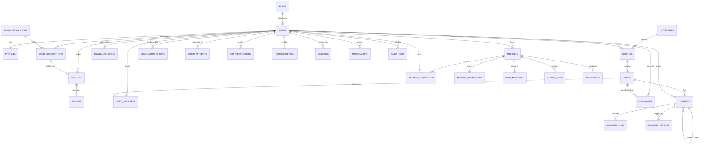

# Bastion Academy — Entity Relationship Diagram

## Notes on key relationships

- **users → roles**: many-to-one, since a role (Free/Bronze/Silver/Gold/Instructor/Admin) is a coarse permission tier; plan-level entitlements live in `user_subscriptions`, not on the role itself, so a user's *plan* can change without their *role* changing (an Instructor is still an Instructor whether or not they personally subscribe to Gold).
- **user_subscriptions → payments**: `payments.user_subscription_id` is nullable, so a Free-plan subscription can have no linked payment. The current schema does not make this FK unique, so it permits multiple payment rows to reference one subscription.
- **meetings → recordings**: the schema permits multiple recording rows per meeting; it does not enforce the one-recording-per-meeting cardinality. Media capture/storage is not implemented yet.
- **comments → comments (self-referencing)**: `parent_comment_id` nullable; deleting a parent with replies soft-deletes it (`status = 'deleted'`, content replaced with a tombstone) rather than cascading, so replies remain readable — this is the Section 10 edge case ("deleted parent comment with replies").
- **download_quota** is a separate table from `downloads` (the audit log) specifically so the quota check is a single indexed row lookup/upsert under a transaction, rather than a `COUNT()` over the full downloads history — this is what makes the race-condition protection in Section 5 practical.
